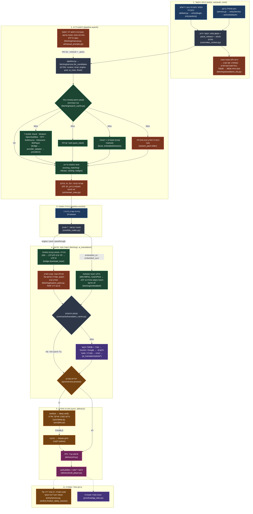

# MoranSubs — `service.subtitles.kodipovilai`

תוסף כתוביות לקודי: מחפש כתוביות עבריות ממקורות אנושיים, מתרגם כתוביות זרות לעברית עם AI (Gemini / Google), מסנכרן אוטומטית,
ומשתף תרגומים דרך מאגר קהילתי. התוסף **עצמאי**: הוא רץ גם לבדו על קודי נקי עם סקין Estuary, בלי ה-Wizard של הבילד.

> This file replaces `ARCHITECTURE_SUBTITLES.md`. Section 8 ("AI & Developer Reference") holds every architectural rule, boundary,
> contract and test rule of that document, so the report can be deleted. Nothing here was tested inside Kodi unless a section says so:
> the Kodi checklist is section 9.

**Contents:** 1 Features · 2 Directory structure · 3 Pipeline · 4 Architecture diagram · 5 The new flows in detail (free-text search,
green words, AI badge, season packs, standalone) · 6 Settings · 7 Public surface · 8 AI & Developer Reference · 9 Kodi checklist

---

## 1. Features and user-facing capabilities

| Area | What the viewer gets |
|---|---|
| **Search** | Seven providers in parallel: Ktuvit, Wizdom, OpenSubtitles, YIFY, SubSource, Subscene, BSPlayer; the community pool; subtitle files beside the video; the video's own embedded tracks. Results are ranked Hebrew first, then AI offers, then foreign languages. |
| **Match %** | One structured release scorer (`scoring_matching/release.py`): only what changes a file's timeline moves the number (episode, frame rate, edition / cut, PROPER, source class, release group, streaming service). Resolution, codec, audio, HDR, container never change it. Equal numbers are tie-broken by full-name similarity. |
| **Chooser window** | `script.moransubs.chooser.xml` on every skin: one row per subtitle (flag, match %, tier word, release name, provider, chips) and an info panel with the match breakdown. Buttons: manual search (202), back to the list (203), cancel translation (204), subtitle settings (205), close (201). |
| **Manual search (VLSub style)** | One free-text prompt, pre-filled with the playing release. Type a title, `Title Year`, `Show S01E03`, or only release words (`FLUX`, `WEB-DL x265`). See 5.1. |
| **Green release words** | Words a subtitle's release shares with the playing release (resolution, source, codec, audio, HDR, group) are green. See 5.2. |
| **Red conflict words** | Whole tokens of a subtitle's release that contradict the playing file's timeline (CAM / TS vs retail, bonus content, another cut / edition, HDTV / PAL / NTSC vs WEB / BluRay, another frame rate, streaming service or episode) are red. See 5.2. |
| **AI translation** | Gemini (own key) or Google Translate: foreign subtitle → Hebrew, gender-aware (TMDB cast, gender references, proofread), RTL / punctuation repairs, progressive display (first minutes first, the rest follows), a translation cache, pool reuse and (opt-in) pool contribution. Embedded tracks can be extracted from the file (MKV / MP4, local or HTTP range) and translated. |
| **Negative AI badge** | A row that cannot be AI-translated says `ללא תרגום AI` with the reason. See 5.3. |
| **Auto-sync (SubSync)** | Verifies a subtitle's timing against the playing file (embedded cue timeline, provider oracles, audio), corrects it when proven, and learns from the viewer's own delay. A proven correction is written into the subtitle file (`retime.apply_verdict` → `write_fixed`). See 5.4. |
| **Autosub** | On play: picks and applies the best subtitle automatically; fast lane for a strong Ktuvit / Wizdom match (`autosub_fast_apply`), a minimum match (`autosub_min_match_pct`). |
| **Caches** | Search results (24 h + 2 min), downloaded provider files (`Cached_subs_v2`), translations (TTL + size cap), season-pack episodes. See 5.5. |
| **Provenance badges** | A Hebrew provider row can carry one of four positive badges (`תרגום אולפנים`, `צוות תרגום מוביל`, `מתרגם מוכר`, `מעלה בולט`) as a chip, and the right-hand panel has an `איכות ומקור הכתובית` block (translator, sync / fix names, uploader, date, downloads, fixed icon). Evidence: the provider's metadata, the credits read inside a downloaded file, the viewer's own handles (`custom_trusted_uploaders`). Positive only, display only. See 5.7. |
| **Season packs** | The playing episode's file is delivered from a pack; the next episode's file is cached ahead. See 5.5. |
| **Community pool** | Read side by default; sharing is opt-in (`pool_share`). HMAC-signed, human-sync reports, SDH registry. |
| **Standalone** | Works with no Wizard, no custom skin and no library metadata. See 5.6. |

---

## 2. Directory and module structure

```
service.subtitles.kodipovilai/
├── addon.xml · default.py (27 lines, PINNED router) · service.py (26 lines, PINNED router) · changelog.txt · README.md
└── resources/
    ├── settings.xml                   8 categories, comment blocks; ids are stored values (never renamed)
    ├── language/{resource.language.en_gb,resource.language.he_il}/strings.po      ids 30000-32999 only
    ├── config/provenance_allowlist.json   the built-in provenance allowlist (studios, teams, translators, uploaders, syncers, never)
    ├── media/                         flags/ · overlay_bg.png · dark_bg.png · gemini.png   (ONE media tree)
    ├── skins/Default/1080i/script.moransubs.chooser.xml                           PINNED file name
    └── lib/
        ├── pipeline.py                search() / resolve(): the ONLY route to fetching.service / ai_translation.service
        ├── he_sub_match.py            PINNED path, 5 API names, stdlib-only at module level (POV / Umbrella import it by bare name)
        ├── telemetry.py · pyxbmct/    bundled chooser fallback window
        ├── entry/                     plugin.py (HANDLE_ACTIONS / PARAMS_ACTIONS tables) · actions.py · service.py (threads) · migrations.py
        ├── core/
        │   ├── addon.py               LEAF: ADDON_ID + the one cached xbmcaddon.Addon (imports nothing of this add-on)
        │   ├── kodi.py                log / notify / DIALOG_TITLE / make_breather        ← every dialog title comes from here
│   ├── threads.py             log_survivors(): at the end of the service, name every thread still alive and the frames it waits in
        │   ├── provenance_allowlist.py  current(): the shipped allowlist + the setting custom_trusted_uploaders (Kodi side)
        │   ├── settings.py            typed accessors · selection.py (token triple) · link_codec.py (encode_link / decode_link / decode_link_safe)
        │   ├── video_context.py       current_video_info · parse_release · ids cache · release_name(info, policy) · looks_like_token
        │   ├── contracts.py           dataclass sketches (not wired)
        │   ├── srt/{blocks,timing,classify,cues,credits}.py     ONE SRT core; credits.py = the credit grammar (pure)
        │   └── cache/{translation_cache,profile_dir}.py
        ├── fetching/
        │   ├── service.py             list_candidates = dispatcher over search/ stages     (only pipeline.py imports it)
        │   ├── search/{state,engine,pool,ai_rows,rows}.py   SearchState (23 slots), stage(S) → NEXT
        │   ├── bridge.py              engine ↔ add-on: search, download_inner, build_video_data, season-pack hook, caches
        │   ├── provider_adapter.py    the ONLY importer of providers/  (the adapter boundary)
        │   ├── providers/             engine.py · general.py · extract_sub.py · meta.py (row metadata parsers, pure) · sources/{ktuvit,wizdom,opensubtitles,yify,subsource,subscene,bsplayer}.py
        │   ├── manual.py              VLSub query: parse_query, build_info, resolve_ids, rank_by_tokens (pure)
        │   ├── season_pack.py         pack detection, per-episode cache, next-episode index (pure)
        │   ├── standalone_ids.py      TMDB → IMDb id for a video Kodi gave no ids
        │   ├── search_cache.py · subs_cache.py · local.py · pool_client.py · pool_harvest.py
        │   ├── provenance_sidecar.py  credits of downloaded files: key, scan, store, attach (written only from bridge.download_inner)
        │   └── embedded/              streams.py · extraction.py · embedded_mp4.py · mkv_probe.py · mp4_probe.py · extract/ (14 modules)
        ├── scoring_matching/{release,ranking,badges,provenance}.py       release.py and provenance.py stay stdlib-only
        ├── ai_translation/
        │   ├── service.py             resolve = dispatcher over job/ stages     (only pipeline.py imports it)
        │   ├── job/{state.py, links/*, ai/*}   JobState (76 slots) · link-type branches · the AI flow
        │   ├── context/{prompt,tmdb_helper,gender_reference→gender/,language_detect}  · providers/{gemini,gemini_pair,google_translate,google_flow,model_fallback}
        │   ├── repairs/ · proofread/ · reuse/ · dispatch/{pacing,srt_wire} · embedded_steps.py · background.py · policy.py · quota.py · source_prep.py · progress.py
        ├── sync/
        │   ├── service.py             process(): the gate · verdicts.py · oracles.py · candidates.py · delivery_record.py · validators.py
        │   ├── deep.py · jobs.py      deep verify, queue + drainer
        │   ├── unsync.py              "בטל סנכרון אוטומטי": restore the original, local veto (action=unsync)
        │   ├── probes/{remote,audio,cache,bundle}.py · align/{common,estimate,verify,regions,piecewise,retime}.py
        ├── delivery/{kodi_player,rtl}.py · delivery/download/{state,links,deliver}.py   DownloadState (8 slots)
        ├── autosub/{player,policy,fast_lane}.py
        └── ui/{chooser,chooser_rows,manual_prompts,listing,dialogs,filename_publisher}.py · ui/settings_actions/{gemini,cache,engine}.py
```

Contract and tests live outside the add-on: `.github/scripts/check_subs_contract.py` · `.github/scripts/subs_contract/` (fixtures, golden
harnesses, `unit_session.py`) · `.github/workflows/subs-contract.yml` (`windows-latest`).

---

## 3. End-to-end pipeline

1. **Entry.** The viewer presses the player's subtitle button (`RunScript(service.subtitles.kodipovilai,action=choose_subs)` → `entry/actions` →
   `ui/chooser.show`), opens Kodi's subtitle dialog (`action=search` → `ui/listing`), or a video starts (`service.py` →
   `autosub/player.autosub_on_play`). All build the video context with `core.video_context.current_video_info()` (InfoLabels, plus
   `parse_release` and the ids cache when Kodi has no library metadata, 5.6).
2. **Search** (`pipeline.search` → `fetching.service.list_candidates`, stages `context → local_files → engine → ai_prep → pool → ai_variants → ai_rows → ai_entries → finish`).
   `engine` calls `fetching/bridge.search`: result cache → `standalone_ids.resolve` → `build_video_data` → `provider_adapter` →
   `providers/engine.c_get_subtitles` (one thread per provider, `max_search_time`, provider-down memory) → `sort_subtitles` (match %) → candidate rows.
   A **manual search** (5.1) goes through the same route with a different `info` (`_manual`, `_query`).
3. **Ranking and display.** `scoring_matching` (match %, same-source test, SDH / gender-source rank), `badges.finalize` (source-screen badge write-through), then
   `ui/chooser_rows.build` makes one row per candidate (columns, green words, chips) and the info panel properties.
4. **Selection and decode.** A pick is a URL-quoted JSON link (`core/link_codec`); seven link types (table in 8.4). `delivery/kodi_player.handle_download` (stages over `DownloadState`) routes:
   embedded → `streams.select_embedded`; `embedded_ai` / `ai` → `RunScript(bg_translate_picker)`; the rest → `pipeline.resolve`.
5. **Acquire.** `bridge.download_inner`: download cache (episode-tagged stem first for packs) → provider `download()` → season-pack step → UTF-8 → cache store → RTL copy.
6. **Translate** (`ai_translation.service.resolve`, stages in `job/`): source prep → translation-cache lookup → pool reuse → Google mode or Gemini
   (context: TMDB cast, gender reference; dispatch: chunking, parallel requests, retries, rate gate; repairs; proofread) → save to cache → optional pool contribution.
   Embedded tracks are read from the file (`fetching/embedded/extract/`, `embedded_steps` windows follow the viewer's position).
7. **Sync** (`sync/service.process`): verdict cache → community registry → deep verify in the background (`sync/deep`, queue in `sync/jobs`): the playing file's embedded cue timeline, provider oracles, audio probe. A proven `FIXABLE` verdict is applied by
   rewriting the file (`retime.apply_verdict` → `write_fixed`).
8. **Deliver.** `delivery/rtl` (Hebrew punctuation / direction) → `player.setSubtitles` with a unique name → registration confirm → `gp_later` proofread.
9. **Background services** (`entry/service.py`): he_warm drainer, sync drainer, sync delay watch (human reports), pool drain, SDH refresh, filename publisher (`subs.player_filename`), gender-proofread runner, daily cache prune, one-shot migrations.

---

## 4. Architecture diagram



---

## 5. The new flows in detail

### 5.1 Manual search, VLSub style (button 202, "חיפוש כתוביות ידני")

* **Prompt** (`ui/manual_prompts.ask`): ONE input, "חיפוש מחרוזת כתובית", pre-filled with the playing release name (`video_context.release_name(info, 'chooser')`, else `Title (Year)` / `Show S01E03`). An emptied box or Escape cancels.
* **Parsing** (`fetching/manual.parse_query`, pure): the title is what comes before the first year, `SxxEyy` / `1x03` or technical word (resolution, source, codec, audio, HDR, PROPER ...); the rest are release words (split at hyphens, one-character pieces dropped). A query with no title part is a **keyword search on the playing video**; so is a lone ALL-CAPS word (`FLUX`) or a lone word of the playing release. A one-word title must be typed in normal case or with its year.
* **Info** (`manual.build_info`): `_manual`, `_query` (raw text), `_query_tokens`, and `_query_keyword_only`. Same title and episode as the playing video → ids kept; another title → `imdb_id` / `tmdb_id` / `dbid` cleared and `resolve_ids` asks TMDB (the engine's `manual_search_for_imdb_id`). An `SxxEyy` makes an episode; a title with no marker that is not the playing title is a movie. `self.info` of the chooser is NEVER replaced: a pick is downloaded, translated, synced and shared with the playing video.
* **What each provider does with free text** (audited 20 Nov 2026):

| Provider | With an IMDb id | With no IMDb id (TMDB did not resolve) |
|---|---|---|
| OpenSubtitles | its own variants, after the raw text | the raw text is sent FIRST as `query`, then title / year variants |
| Ktuvit | page matched by IMDb id | title search; exact-title match (English or Hebrew name, letters and digits only) |
| Subscene | search by id | search by the title text; a blank year no longer raises |
| SubSource | search by id | search by the title text (first hit) |
| Wizdom, YIFY | by id | cannot search (id-only APIs) |
| BSPlayer | file-hash of the PLAYING file | left out when another title is typed (kept for a keyword search) |

* **Not dropped by filters:** the 24 h and 2-minute result caches are keyed by the typed text (a manual list is never the automatic list, another text is another list); the manual `info` keeps the release fields so the match % is still scored against the playing release; `_manual` skips only what belongs to the playing file (files beside it, its embedded tracks, the Ktuvit pool harvest).
* **Ranking** (`manual.rank_by_tokens`): rows holding every release word first, then rows holding some (more words first), then the rest; nothing is dropped; a toast says when no row holds them all.
* **Window:** `subs.head` = `חיפוש ידני: <text>`, `subs.manual` = 1, button 203 "חזרה לרשימה" restores the automatic list (also when its background completion arrived meanwhile); a generation counter drops a replaced search.

### 5.2 Green release words (`ui/chooser_rows.py`)

`release_spans(name)` cuts a name into WHOLE tokens (0.3.106): by pattern, resolution (`1080p`, `4K` ≙ `2160p`), source class (`WEB-DL` / `WEBRip` / `WEB` → web; `BluRay` / `BDRip`; `REMUX`; `HDTV`), HDR (`HDR10+`, `DV`), video codec (`x265` ≙ `H.265` ≙ `HEVC`; `x264` ≙ `AVC`), audio (`DDP5.1`, `DD+5.1`, `Atmos`, `DTS-HD MA`, `TrueHD`, `AAC2.0`) and the trailing release group (never a file size, `LOSSLESS`, `CLEAN`, `DUAL`: `scoring_matching/release.is_group_token`) and every other word (title words, the year). A compound tag is ONE token and source tags are compared as written (`WEB-DL`, `WEBRip` and `WEB` are different tags: never a green `WEB` with a white `-DL`). `shared_mask(release, playing, want)` marks every whole token the playing release also has (a tag: same category and value; a word: the same word) and every token made only of words of the manual query. `strip_bbcode` removes stray `[B]` / `[/B]` / `[COLOR]` tags from a row's label. `paint` closes and reopens `[COLOR]` segments (never nested); `wrap_release(..., mask=)` keeps the paint through the wrapping. Used for the release column and the info panel's full release name. The highlight never changes a number.

**Red conflict words (0.3.109).** `conflict_mask(release, playing)` marks every WHOLE token of the subtitle's release that contradicts the playing release on a timing point, in `RED` (the warning red of the `ללא תרגום AI` chip): another source tier (`CAM` / `HDCAM` / `TS` / `TELESYNC` / `HDTS` / `TC` / `TELECINE` / `SCR` / `SCREENER` / `DVDSCR` / `R5` / `WORKPRINT` against `WEB-DL` / `WEBRip` / `BluRay` / `DVDRip`, both ways), bonus content the playing file is not (`Trailer`, `Teaser`, `Promo`, `Making.Of`, `Behind.The.Scenes`, `Featurette`, `Extras`, `Bonus`, `Deleted.Scenes`, `Recap`, `Sample`), another cut / edition (`Extended`, `Director's.Cut` / `DC`, `Unrated`, `Uncut`, `IMAX`, `Remastered`, `Special.Edition`, `Criterion`; an untagged file is the theatrical cut), a broadcast capture against WEB / BluRay (`HDTV`, `PDTV`, `SDTV`, `PAL`, `NTSC`, both ways; `PAL` vs `NTSC`), another frame rate (`25fps` vs `23.976fps`; `PAL` = 25), another streaming service (`NF` vs `AMZN` ...; table: `scoring_matching/release.service_token`) and another episode (`S01E02` vs `S01E01`, `S01E01E02` / `S01E01-E02` vs `S01E01`). Each token carries facets (`_facets_of`); a token is red when the playing release has the same facet with another class (`_clashes`); a facet the playing release does not mention is no conflict, except bonus content and a special cut. WEB vs BluRay is NOT red. Ambiguous short words (`Cam`, `TS`, `TC`, `SCR`, `R5`, `DC`, `PAL`, `NTSC`) are tags only after an anchor (year, SxxEyy, resolution, source / codec / audio / HDR tag, frame rate); an edition / bonus word is never the first word; a service only among the technical tags (the scorer's rule). `release_mask(release, playing, want)` gives one colour per character (`RED` > `MATCH` > none; a conflict wins over a manual-query word) and `paint` takes it (a `True` entry is still `MATCH`). Display only, like the green.

### 5.3 The negative AI badge

AI translation is the normal case and has no badge. `chooser_rows.no_ai_reason(typ, is_ai, is_he, embedded, ai)` returns the Hebrew reason a row **cannot** be AI-translated, and the chip `ללא תרגום AI` shows (the reason is in the info panel's kind line). Context (`ui/chooser._ai_context`): `translation_mode == 'none'` (AI off); `'ai'` mode with no Gemini key (Google mode needs no key); embedded-track translation off (`embedded_translation_mode == off`) or `local_only` on a stream; the playing file's embedded track already tried and unreadable. Picture tracks (PGS / VobSub) cannot be read by `extract_embedded_srt`: it first tries the file's other text tracks (en, es, de, fr, pt), then the best external subtitle of the release (`external_for_unreadable_embedded`); only when both fail `note_embedded_miss(reason)` runs, now also writing `moransubs.embedded_miss` (`{reason, file}`) so the chooser (another process) knows. Rows never marked: Hebrew rows (they need no translation), pooled translations (delivering them calls no translator). Without a context nothing is claimed.

### 5.4 Auto-sync file shift

* A `FIXABLE` verdict (one global offset, a speed change or several regions) is applied by rewriting the SRT timestamps (`retime.apply_verdict` → `write_fixed`); Kodi's own subtitle delay is not touched by the add-on's auto-sync. (A variant that carried a pure global offset in Kodi's delay was built and reverted on 20 Nov 2026 before release.)
* The viewer's own delay changes are still read by the delay watcher (`entry/service.py`) and become a human timing report (`finalize_delay_session`, origin `human`). The watcher and the community reporting are untouched by the badge / cancel below.

#### 5.4.1 The auto-sync badge (`subs.sync.*`) and "בטל סנכרון אוטומטי" (`action=unsync`)

* **Window properties** (Home window, `Window(10000)`; `core/selection.py`): `subs.sync.offset` and `subs.sync.mode`, published when a fix is CONFIRMED (Kodi has the corrected file: `confirm_subtitle_sync_fix` for a staged fix, `publish_selection_status('fixed', badge=...)` for a background swap) and cleared when the status changes to anything else, when `clear_subtitle_sync_status()` runs and when another subtitle is selected (`set_current_subtitle`). Re-selecting the same row keeps them. Both are empty unless the CURRENT selection is `fixed`.
  * `subs.sync.mode`: `offset` (one global shift), `scale` (speed change, `scale != 1`), `piecewise` (several regions).
  * `subs.sync.offset`: the Kodi-equivalent delay, `+` = the subtitle appears LATER (the sign of Kodi's delay slider; `verdict.offset_ms` moves the other way): `+2.5s`, `-1.2s`; the Hebrew word `שינוי קצב` for `scale`, `מקטעים` for `piecewise`; empty for a zero shift (the mode is still set).
  * ONE helper builds every text: `sync/common.describe_fix` / `sync_notice` / `fix_badge`. The three toast builders (`jobs._announce`, `jobs.fix_notice`, `jobs.status_line`) and the badge use it, so the words agree everywhere (the toast keeps its Hebrew unit: `הכתובית סונכרנה אוטומטית (+2.5 שנ׳)`; a scaled / piecewise fix now says so in the brackets).
  * A skin shows the value in its OWN label control (a Latin number next to Hebrew words reorders under bidi): `$INFO[Window(10000).Property(subs.sync.offset)]`, visible while `!String.IsEmpty(Window(10000).Property(subs.sync.mode))`. Shown by the chooser header (`script.moransubs.chooser.xml`) and by FENtastic's OSD layouts (`Includes_VideoOsd1..4.xml`, marker `AUTO_SYNC_BADGE_v1`).
* **Undo record** (token-scoped window property `moransubs.current_subsync_undo.<token>`, local): the unshifted file and the verdict keys (`sub_hash|cut_signature`) of the fix; staged with the fix (`stage_subtitle_sync_fix(..., badge=...)`), read through `core.selection.get_sync_undo`.
* **`action=unsync`** (chooser button 206, visible only while `subs.sync.mode` is set; skins may call `RunScript(service.subtitles.kodipovilai,action=unsync)`), `sync/unsync.cancel_auto_sync`: (1) the original file is re-delivered through `core.selection.apply_subtitle_file` (Kodi's external-subtitle slot is replaced; it is refused when the file was replaced by a later download, because the key's `sub_hash` must still match its text); (2) only after Kodi took it: the `subs.sync.*` properties and the FIXED status are cleared, the delivery record is reset to scale 1.0 / offset 0 (the delay watcher then learns from the unshifted file), and every key of the fix gets a LOCAL veto (`verdicts.store_veto`, status `USER_VETO` in `subsync_verdicts.json`). Nothing is sent to the community pool (the module imports no pool code).
* **The veto**: `sync/service.process` checks it right after the cache key, before the release-trusted tier, the verdict cache, the community registry and the deep job: the file is delivered as it is, no job is queued. `jobs` skips a vetoed row in the autosub tournament; `store_verdict` never lets a background verdict replace a veto; the cache trim keeps vetoes first; a `VERDICT_VERSION` bump does not drop it (`is_vetoed` ignores the stamp). Only the viewer's own confirmed manual delay (`store_human_verdict`) replaces it.

### 5.5 Caches, translation reuse, seek, season packs

* **Previous run:** a translation is cached under `(imdb_id, season, episode, source_lang, source_id[, tier])` (`core/cache/translation_cache`); `source_id` is the content hash of the source SRT (`source_prep.source_id_for_ai`), so re-picking the same provider row (the download comes from `Cached_subs_v2`, no network) hits the translation cache at once (`ai_translation/job/ai/cache.py`: "Cache hit (early)" / "(content)"); the golden-resolve harness has the scenario "the same link again: the cache answers". The `[CACHE]` marker of list rows uses the same untiered key (the tier-pinned early return is deliberate, see the long comment in `job/ai/cache.py`: do not widen it without wiring it to `progressive_cb`). A manual search does not change the key (it is built from the playing video's info).
* **Seek during progressive translation:** `embedded_steps.EmbeddedSteps` keeps `_he` (start → Hebrew), `_read` and `_covered` append-only; `moved()` only cuts the window being read, never the translated lines; the dispatcher's `chunk_dispatch_order` puts the visible part first without changing cue order. Verified by reading the code; a seek never flushes translated chunks.
* **Season packs** (`fetching/season_pack.py`, called from `bridge.download_inner` right after the provider's `download()`):
  1. a pack is recognised by content: the download folder (emptied before every fetch) holds ≥ 2 `.srt` whose names carry different `SxxEyy` / `1x03` tags;
  2. the file of the PLAYING episode is delivered (before, the provider's first file was served for every episode);
  3. it is stored under the episode-tagged stem `<source>_<language>_<filename>.S01E02`, and the next episode's file (`S01E03`, else the first of the next season) the same way; the untagged stem is never written for a pack. The download-cache lookup checks the playing episode's tagged stem first;
  4. a Hebrew next-episode file is also kept in `profile/season_pack/index.json` (24 entries, 21 days) so `fetching/search/state.local_files` offers it at once as a local passthrough row for that episode, even if no provider lists the pack there;
  5. RAR archives are unpacked through Kodi's `rar://` virtual file system (`vfs.rar`) when present.
  Not removed: the providers' own search still runs for the next episode; only the download (and, for Hebrew, the first row) is saved.

### 5.6 Standalone operation

Audited 20 Nov 2026: no code, XML or setting of the add-on names the Wizard, `uservar`, `povil_icons`, a skin, POV or Umbrella (the contract test enforces the Wizard / `uservar` / `povil_icons` part). The chooser XML uses no skin include and no font name. Metadata comes from stock InfoLabels (`VideoPlayer.UniqueId(imdb|tmdb)`, `IMDBNumber`, `Title`, `Year`, `Season`, `Episode`, `TVshowtitle`, `Player.Filenameandpath`, `ListItem.*`); the release hint `subs.player_filename` is published by the add-on's own `ui/filename_publisher`. Added for a plain file on stock Estuary: `video_context.parse_release` reads title / year / season / episode out of the file name when Kodi gave no ids and a file-like title, and `fetching/standalone_ids.resolve` asks TMDB once per title for the IMDb id (kept in the window property `moransubs.ids_cache`, so every later `current_video_info()` carries it). Without the id Wizdom, YIFY and SubSource cannot search. The TMDB cast for gender context comes from the user's `script.module.tmdbhelper` key if present, else a bundled public key.

### 5.7 Hebrew subtitle provenance: four positive badges and the quality block

A Hebrew row of a provider (Ktuvit, Wizdom, OpenSubtitles ...) can carry ONE of four **positive** badges, shown as a chip in the row and
explained in the right-hand panel. Owner rules (20 Nov 2026), enforced by the contract:

* **Hebrew provider rows only.** Foreign, machine-translated (`[תרגום מכונה]`), AI, pool and embedded rows never get a badge.
* **Positive only.** There is no "unverified" and no "AI" state; a row without evidence has no chip and no wording, it just shows the provider's raw metadata.
* **Display only.** A badge never hides, reorders or demotes a row and never blocks auto-sub.
* **Sync / fetch / fix credits never give a badge** (a machine translation can be synced); they are shown apart as names (`סנכרון / תיקון`).
* OpenSubtitles' `from_trusted` flag is NOT a signal and is not even recorded; the bulk importer `os-auto` (rank `Application Developers`) is never trusted.
* Every claim names its source: the provider, or `קובץ הכתובית` (the credits read inside the downloaded file). `אולפנים` is a claim typed by the uploader.

| Badge (chip text) | Constant | Evidence (highest wins) |
|---|---|---|
| `תרגום אולפנים` | `VERIFIED_STUDIO` | translator field `אולפנים`; a studio on the allowlist; a studio form (`הפקת כתוביות`, `תרגום כתוביות:`, `עברית:`, `Subtitles Source:`, `(אולפנים)` / `(נטפליקס)` after a translator) |
| `צוות תרגום מוביל` | `VERIFIED_TEAM` | a known team in the translator role (or a team account as uploader, or `Qsubs מצוות` without a sync verb) |
| `מתרגם מוכר` | `VERIFIED_TRANSLATOR` | an allowlisted or user-added translator in the translator role, or an explicit translated-by-ear credit (`תורגם משמיעה`) |
| `מעלה בולט` | `TRUSTED_UPLOADER` | an allowlisted uploader (Ktuvit staff included) or a handle the user added |

**Where the evidence comes from** (nothing is downloaded for it during a search):

1. *Provider metadata at search time* (`fetching/providers/meta.py`, pure parsers). Ktuvit: the row's credit lines (`תרגום: ...`, `סנכרון: ...`, `הביא: ...`), uploader, `DD/MM/YYYY` date, downloads, the `כתובית מתוקנת` wrench icon. Wizdom: `/api/releases/<imdb>` once per title (24 h, `providers/cache`), joined on the subtitle `id` (it raises on failure, because the cache would keep an empty answer). OpenSubtitles: `attributes` (uploader, rank, `upload_date`, `download_count`, `comments`) and the release name as sent (`release_raw`, kept only when it carries `אולפנים`; the visible name is still stripped). Each provider puts an optional `meta` dict on its row, `engine.sort_subtitles` appends it as the 11th tuple field, `bridge._engine_rows` carries it as the candidate's `_meta` (plain JSON, so the 24 h search cache keeps it; rows cached before the feature have none until they expire).
2. *Credits inside a downloaded file* (the sidecar, below).
3. *The viewer's own handles*: setting `custom_trusted_uploaders` (Matching & Display), comma separated, merged with the built-in list: a handle there is a trusted uploader and a known translator.

**The classifier** (pure, stdlib only): `core/srt/credits.py` is the ONE normaliser and credit grammar (NFKC, bidi controls, `?` left by cp1255; both text orders, `Afenla :תרגום וסנכרון` and `תרגום וסנכרון: Afenla`; the spellings `תרגום` / `תורגם` / `תירגום` / `תירגם`; Hebrew FINAL letters matter in the patterns). `scoring_matching/provenance.py`: `classify(meta, allow, hebrew=, provider=, cue_infos=)` returns the badge, every reason (badge, source, field, text, match) and the panel fields. A name is matched WHOLE (case, spaces, dots, underscores and hyphens ignored: `yoav_1610` = `Yoav1610`), never as a substring. The older `cues._CREDIT_RE` filter is untouched; the grammar knows every Hebrew word it knows (a contract check pins that).

**The allowlist** is `resources/config/provenance_allowlist.json` (add-on local, no remote fetch): `studios`, `teams`, `translators`, `uploaders`, `syncers` (panel only), `never`. An entry is a name or `{name, aliases, evidence}`; `evidence` says where it came from (the 2019-20 Telegram corpus, the 20 Nov 2026 probe, an owner decision) and is ignored at runtime; `"status": "proposed"` keeps a suggestion unloaded. Full credit forms only (`יואב שילוח`, never a bare `Yoav`); a name shorter than 3 letters / digits is never loaded. `core/provenance_allowlist.current()` loads it once per interpreter and again when the setting changes; the chooser and the sidecar share it.

**The chooser** (`script.moransubs.chooser.xml`, `ui/chooser_rows.py`): the badge is a chip in `b1..b3` (priority: current, provenance, the rest). The right-hand panel is ONE vertical `grouplist` of fixed-height rows; an empty row is hidden and the rows below move up. Order: match number, `שם השחרור` (4 lines at most), a divider, **`איכות ומקור הכתובית`** (`לפי <provider>` is a row of its own so `OpenSubtitles` fits), a divider, **`פרטי התאמה`** with the match rows (`פרק` ... `תזמון`), a divider, `פרטי הכתובית`. The badge (chip and `p_prov`) is blue, the blue of the provider names (`PROV_BLUE`); green stays for shared words, red for conflicts. Properties (every row emits all of them, empty when it has none; each holds ONE value, the Hebrew captions are static XML text so a Latin handle never mixes with Hebrew in one control): `p_prov` (badge), `p_prov_src` (who claims it), `p_translator`, `p_sync` (names only), `p_uploader`, `p_date` (ISO), `p_downloads`, `p_fixed`, `has_meta` (shows the block). The worst case (every row shown) is 794 of the grouplist's 820 pixels; the contract adds the heights up. **Window layout (0.3.109):** margins 24 / 16; header row 1 = brand, the searching status (`subs.count`, centred), the counter; header row 2 = the playing release across the whole left side; four framed cards: the list (780 px = 8.5 rows, the half row is the scroll hint), the colour legend (with `חזרה לרשימה` 203 and `בטל סנכרון אוטומטי` 206 on its right), the button bar `205 204 202 201` (one uniform row of 4) and the info panel (flush with the top of the list card and the bottom of the bar); the auto-sync badge sits in the header over the info panel.

**The download-time sidecar** (`fetching/provenance_sidecar.py`). A subtitle that is downloaded ANYWAY has the first and last 8 cues of its file read once for credit lines. Hooks, all in `bridge.download_inner` (the one funnel: the viewer's pick, auto-sub, SubSync's reference fetches and the Ktuvit pool harvest all use it): a fresh download; a cache hit (a file fetched before the sidecar existed is scanned once from disk, an existing entry is never overwritten); and a season pack's members (`_note_pack_credits`, one entry per episode tag). Hebrew downloads only. Stored in `<profile>/provenance/credits.json`, outside `Cached_subs_v2` (which is wiped past 200 files): `{"v":1,"e":{key:{"t":time,"h":content-hash,"n":cue count,"l":[credit lines]}}}`, key `ktuvit:<SubtitleID>` / `wizdom:<id>` / `opensubtitles:<file id>` / `<source>:n-<hash>` (+ `:S01E02` for a pack member), at most 4,000 entries (the oldest go first), written atomically. Only credit-like lines (or lines naming an allowlisted name) are kept: never subtitle text. `chooser._chooser_items` calls `attach()`, which puts the stored lines on the provider rows as `_file_credits`; a row shows file credits only after its file was fetched once. Nothing in a search writes or scans: the contract checks that `record` / `record_many` are called only from `bridge.py` and `attach` only from `chooser.py`. Every entry point never raises, so the sidecar can never break a download.

**Extending it.** A new studio / team / translator / uploader is one allowlist entry with its `evidence`. A new credit word goes in `core/srt/credits.py` with a unit case (mind the final letters). A new provider emits an optional `meta` dict with the same keys (`credits`, `uploader`, `uploader_rank`, `date`, `downloads`, `fixed`, `comments`, `release_raw`). Tests: `unit_provenance_meta.py` (provider parsers, the tuple, `_meta`), `unit_provenance.py` (grammar, the badges, the allowlist, the 250 recorded Telegram credit lines), `unit_provenance_ui.py` (chip, properties, XML panel, the setting, the loader), `unit_provenance_sidecar.py` (file helpers, key, store / prune / attach, the `download_inner` hooks against a fake provider); fixtures in `subs_contract/fixtures/provenance/` are trimmed live captures.

**Limits.** Not tested in Kodi (see the checklist). The allowlist is small and positive only: a human translator who is not on it gets no badge (the draft covered about 60 % of the translation-credit lines among the 250 most frequent corpus lines). How often an AI pipeline spoofs a credit is unmeasured. Only the first and last 8 cues are read.


### 5.8 The chooser window is served by one thread (21 Nov 2026)

Kodi 21.3 crashed (access violation at `0x726574`, thread of `action=choose_subs`, dump `kodi_crashlog ... 203023`) inside `RetardedAsyncCallbackHandler::makePendingCalls()`: a queued window callback was dispatched on memory that a `xbmcgui.ListItem` now occupied, while a background thread was rebuilding list 100 (369 `ListItem`s, `reset()`, `addItems()`). Which reference Kodi released early is not proven; the rule removes the pattern.

* **One owner thread.** `ui/chooser._run_owner_loop(win, xbmc.Monitor())` replaces `doModal()`: `win.show()` (the call `doModal()` makes first) and then `Monitor.waitForAbort(0.05)` in a loop; Kodi runs the window's callbacks (`onInit` / `onAction` / `onClick`) between its slices, on this thread. The loop ends when `win.close()` sets `closed` (Back / Esc reach it through `onAction`: `ACTION_PREVIOUS_MENU` 10, `ACTION_NAV_BACK` 92, also 9 / 216 / 247; a pick through `_deliver_pick`; button 201) or when Kodi aborts (the window is then closed, as `doModal()` does). A callback reaches the loop up to one tick (50 ms) later than with `doModal()`.
* **Every `xbmcgui.ListItem`, control call and window property is made on that thread.** `_ChooserXML._apply(items, rows)` is the only place that makes `ListItem`s and touches list 100. `_complete()` (the full list) and `_run_manual()` run on background threads and produce plain Python only: the candidates and the row dicts of `chooser_rows` (`_rows`, pure); they hand them over with `_post(job)`; `pump()` runs the jobs on the owner thread and drops them once the window is closed. No lock is needed: all window state (`items`, `pending`, `manual`, `base`, `manual_gen`) changes on the owner thread. `kodi.notify` toasts stay on the background thread (they are not window calls).
* **New chooser code follows the same rule:** a background thread never creates a `ListItem` and never calls a control; it posts. `.github/scripts/subs_contract/unit_chooser_threads.py` (17 checks, a fake Kodi runtime that records the thread of every `ListItem` and control call; Back, Esc, abort, Close button, a late background list) fails when it does.

---

## 6. Settings (`resources/settings.xml`)

8 categories: General, Providers & Fetching, Matching & Display, AI Translation, Sync Engine, Community Pool, Cache, Advanced & Debug. ~95 settings (`custom_trusted_uploaders`, Matching & Display, level 1, labels 32656 / 32657: extra trusted uploader / translator handles, comma separated, read when the chooser opens); ids are stored values and are never renamed. Rules: every id read or written in code (literal or through a `*SETTING*` constant) is declared; label ids exist in both `strings.po` files (en_gb, he_il, same ids); **string ids stay inside 30000–32999** (Kodi owns ids ≥ 33000); no `%` inside a label (listed exceptions only). Recent ones: `autosub_fast_apply` (32652 / 32653), `autosub_min_match_pct` (32654 / 32655), `gemini_rpm` (32627 / 32628), search languages (32615–32619, 32629), `subtitle_trans_cache` (integer, default 200, step 1, max 1000).

---

## 7. Public surface (byte-identical; other add-ons, skins and the Wizard call it)

* Kodi hooks: `xbmc.subtitle.module` = `default.py`, `xbmc.service` = `service.py`; `subtitles.tv` / `subtitles.movie` in `guisettings.xml` = the add-on id.
* `RunScript(service.subtitles.kodipovilai,action=...)`: `choose_subs` (skins), `connect_gemini` (frozen Wizard patch `pov_myservices`), `search`, `manualsearch`, `download`, `translate_file`, `bg_translate_picker`, `he_avail`, `cancel_translation`, `unsync` (cancel the automatic sync of the current subtitle, section 5.4.1), and the settings buttons (`open_aistudio`, `test_connection`, `show_gemini_usage`, `open_tmdb_notice`, `clear_cache`, `pool_share_cache(_run)`, `purge_temp`, `engine_test`). The Telegram actions are gone for good.
* `Addon.OpenSettings(service.subtitles.kodipovilai)` (Wizard `skins/af3_tools`, `profiles/build_profiles`, Onyx `Home.xml`, `widget_baselines`).
* Window properties: `subs.player_filename`, `MoranSubsChooserOpen`, `povil.embedded_*`, `moransubs.*` (new: `moransubs.embedded_miss`, `moransubs.ids_cache`, `moransubs.current_subsync_undo.<token>`), `subs.sync.offset` / `subs.sync.mode` (the applied auto-sync, section 5.4.1).
* `resources/lib/he_sub_match.py`: imported by bare name by POV / Umbrella hooks (`prewarm`, `release_names`, `embedded_names`, `confirmed_releases`, `label_prefix`).
* The Wizard reads no setting of this add-on (the helpers `host_repairs/kodi_utils.subs_get_*` are the only sanctioned way); it names the add-on id only as an existence reference.

---

## 8. AI & Developer Reference

Everything below was carried over from `ARCHITECTURE_SUBTITLES.md` (Parts 1, 2, 4, Appendices) and the subtitle rules of `CLAUDE.md`. It is the contract for any
future change by a person or an AI assistant.

### 8.1 Ownership and decoupling

* **We own the subtitle core.** It is decoupled from MoranSubs (owner decision 19 Nov 2026): no upstream merges, no sync script. Architectural refactoring is encouraged: move, rename, split, with **NO SHIMS** (update every import, delete the old path).
* **Behaviour stays the same unless the owner approved the change.** Report bugs instead of fixing them silently; a fix is its own labelled change. Dead-code deletion and the `settings.xml` reorganisation were approved. Behaviour changes approved since: match scoring and the chooser (Step 6), the tie-break / fast lane / minimum match (Step 8), the chooser on every skin and manual search (Step 9), and this release (5.1–5.6).
* **Nothing naming the Wizard, `uservar`, `povil_icons` or build markers may enter the add-on.** Dialog / toast / progress titles come from `core.kodi.DIALOG_TITLE`, never a literal ("Kodi POV IL" literal is forbidden outside `core/kodi.py`). Helper modules are `core/{addon,kodi,settings,selection}.py`; never name one `kodi_utils` or `sub_utils` (`kodi_utils` is POV's module and the Wizard's).
* **Do not restore:** `POOL_API_KEY` (deprecated, HMAC signing since 0.2.290), the Telegram source (`telegram.py`, `telegram_impl.py`, its actions, settings and labels), the DarkSubs machine-translate stack (Google / Bing / Yandex translators of the vendored engine, `download_sub`), `fetching/providers/srt.py`, `auto_translate`, `translate_p`, `auto_remove_hi_tags`. `auto_fix_sub_punctuation` is read in `fetching/bridge.py` (keep it declared, hidden).
* **Do not take upstream Onyx 1.0.10–1.0.20** or the upstream Wizard-only features (ratings, home trailers, hub tab ...) without the owner: they need Wizard features this repository does not have (`CLAUDE.md`, "SKIPPED UPSTREAM FEATURES").

### 8.2 Layering and import rules

* **Import direction:** `entry → pipeline → feature packages (fetching, scoring_matching, ai_translation, sync, delivery, autosub, ui) → core`. A feature never calls another feature's private helper.
* **Public names:** no module imports or reads a `_name` of another module; a name another module needs is public in its home. The only frozen exception is `fetching/pool_client._lookup_raw` (read by `he_sub_match`, listed in `baseline.json`).
* **Single route:** everything outside `fetching/` and `ai_translation/` reaches `list_candidates` / `resolve` only through `pipeline.search(info, modal_progress=True, quick=False, on_provider=None)` / `pipeline.resolve(link, info, **kwargs)`. The contract test fails if another module imports `fetching.service` or `ai_translation.service`.
* **Provider boundary:** `fetching/provider_adapter.py` is the ONLY importer of `fetching/providers/`; the loaders stay lazy (the engine's cold import is 13–20 s on a 32-bit box). Provider contract: each `sources/*.py` module exposes `global_var` (list that `get_subs` fills), `site_id`, `get_subs(video_data[, all_lang_override])`, `download(download_data, MySubFolder) → path`.
* **`core/addon.py` is a leaf** (imports nothing of this add-on); `core.kodi` and `core.settings` rest on it and do not import each other; no function-level import of this add-on inside `core/kodi.py` / `core/settings.py`; `core/` has no module-level import cycle and does not import `sync/` (`MIN_CUES` / `STATUS_UNKNOWN` live in `core/srt/cues`). `core/utils/` must not exist (audited: nothing belongs there).
* **No empty `__init__.py` in subfolders** (namespace packages, `xbmc.python` 3.0.0). Only `resources/lib/__init__.py` and the pre-existing ones.
* **Function-level imports that break a cycle stay inside the function** until the cycle is gone.
* **`scoring_matching/release.py` stays stdlib-only** (the flat fallback of `he_sub_match` imports it). **`he_sub_match.py`** keeps its path, its 5 API names and its stdlib-only module-level imports; its two formerly private helpers are `dbg` / `warm_queue_dir`; every change to it updates `baseline.json` (sha256). The facade split was NOT done: POV and Umbrella import it from their own interpreters, where `resources` is POV's package; needs a Kodi test in both interpreters first.
* **Stage protocol:** big functions are dispatchers over `stage(S)` functions over one `__slots__` state object (`JobState` 76 slots, `SearchState` 23, `DownloadState` 8); a stage returns `NEXT` to continue or the final value; every shared variable is `S.<attr>`.
* **Unified Core + Thin Wrappers** is the pattern for duplicates: one pure core, thin wrappers that keep their I/O and policy and exact result (one RTL text core `delivery/rtl.rtl_text`, one `core/kodi.make_breather`, `decode_link_safe`).

### 8.3 The playing release: ONE function, six named policies

`core.video_context.release_name(info, policy)`; the token test is `looks_like_token(s, blank=False)`. Never write a seventh copy. The six disagree on 83 of 120 recorded fixtures on purpose (owner decision: keep all six exactly as they were).

| Policy | Caller | Rule |
|---|---|---|
| `picker` | `fetching.search.*` (match % of the picker, pool rows, same-source gate) | first truthy of `picked_release`, `tagline`, `label`, then `li_filename` as a release name, `basename(filepath)`, `title` |
| `chooser` | `ui.chooser` (header), `ui.manual_prompts` (the pre-fill) | first truthy of `picked_release`, `tagline`, `label`, `title` |
| `sync` | `sync.service.playing_release` | first of `picked_release`, `tagline`, `label`, `basename(filepath)`, `title` that is truthy and does not name another episode, stripped |
| `scored` | `fetching.bridge.build_video_data`, `fetching.search_cache` | every candidate scored by `_release_score`, the best wins, ties to the longer string; other-episode names dropped |
| `pool` | `pool_contribute`, `embedded.streams` | first stripped non-token of `release`, `filename`, `picked_release`, `tagline`, `label`, then `li_filename`, `filepath` as release names |
| `source` | `ai_translation.job` (timing / pool fallback) | first stripped non-empty of `release`, `picked_release`, `filename`, `tagline`, `label` |

### 8.4 Data contracts

* **Candidate row** (`list_candidates` output): `filename` (display label), `language`, `link` (URL-quoted JSON), `sync`, `rating`, `is_hi`, `is_hd`, `pct` (the number the label shows; `None` when it shows none), private `_engine_kind` (`human_he | mt_he | other | embedded_he | embedded_other`), `_pct`, `_is_mt`, `_subsync_state`, `_subsync_label`, `is_cached`. Stars come from `pct`, never from the label. Two embedded rows carry `101` only in their label.
* **Link payload** (`core/link_codec`):

| `type` | Produced by | Consumed by | Key fields |
|---|---|---|---|
| `passthrough` | local file / season-pack index | `resolve` | `path`, `release` |
| `pool` | pool lookup | `resolve` | `hash`, `release`, `pool_kind` (ktuvit / ai / ai_emb), `source_lang` |
| `engine` | `bridge._encode_engine_link` | `resolve`, `handle_download` (embedded) | `source`, `language`, `filename`, download fields, `embedded`, `stream_index`, `lang` |
| `engine_ai` | `list_candidates` (foreign + AI on) | `handle_download` → `ai` | engine fields + `src_lang` |
| `embedded_ai` | `list_candidates` | `bg_translate_picker` → `resolve` | `src_lang`, `stream_index` |
| `embedded_sync` | `list_candidates` | `resolve` | `lang`, `stream_index` |
| `ai` | local / `engine_ai` | `bg_translate_picker` → `resolve` | `source_lang`, `local_path`, `force_ai`, `proofread_only` |

* **`video_data`** (engine input, `bridge.build_video_data`): `imdb, IMDBNumber, imdb_UniqueID, tmdb, title, OriginalTitle, TVShowTitle, year, season, episode, media_type, media_type_ListItem.DBTYPE, media_type_videoInfoTag, file_original_path, Tagline, Tagline_From_Fen, VideoPlayer.Tagline, mpaa, is_local_media_playing, state`, plus (manual search) `query`, `manual`, `keyword_only`. Providers read some keys by bracket access: every key must exist.
* **Selection triple** `{token, link_hash, stream_hash}` (`core/selection`): created at delivery, re-checked by every background job before it replaces a subtitle; stored in Window(10000) properties. A background result that does not match the live selection is dropped.
* **Verdict** (`sync`): `status` (confirmed / fixable / unknown / no_oracle / alternate_applied), `scale`, `offset_ms`, `mode` (`global` | `piecewise`), `segments`, `cut_signature`, `cache_key`, `applied`. A scalar manual-delay record (`record_delivery`) exists only for `mode == global`.
* **Chooser row properties** (`ui/chooser_rows.build`): `release`, `src`, `pct`, `tier`, `b1–b3`, `cur`, `has_panel`, `p_release`, `p_why`, `p_kind`, `p_provider`, `p_lang`, `p_access`, `f_*` / `fs_*` (episode, edition, fps, source, group, service, timing). A new row column = a property in `chooser_rows.build` + a control in the XML; the contract fails when the XML reads a property no row produces. Each column is ONE text direction (no bidi collisions). The chooser XML keeps its name, `MoranSubsChooserOpen`, control ids 100 / 201 / 202 / 203 / 204 / 205 / 206 and the `pyxbmct` fallback.

### 8.5 Contract test and golden baseline rules

* **Run `python .github/scripts/check_subs_contract.py` before any subtitle change is reported done** (needs Windows `os.path` for the golden part, which was recorded with `ntpath`; `--static` skips the interpreter part; CI: `windows-latest`). 66 checks at this release: module imports (164 of 164 under the stubs, one fresh `python -I` per module), `compile()` with warnings as errors, no cross-module private name, no `core/` cycle, no forbidden names, single route, pinned strings, settings ↔ strings consistency, no label id ≥ 33000, 1,435 golden cases, 628 extract cases, 56 resolve scenarios, `unit_session.py` (128 checks), and the four provenance unit files (`unit_provenance_meta.py` 50, `unit_provenance.py` 65, `unit_provenance_ui.py` 46, `unit_provenance_sidecar.py` 33 checks; see 5.7).
* **Golden harnesses** (`.github/scripts/subs_contract/`): `golden.py` (link codec round trips of the 7 types, SRT passes, release scores, the playing-release matrix, `sync_align` pairs, the settings / selection state machine, `list_candidates` ordering, star mapping, chooser rows, the fast lane; `golden_autosub_part.py` runs LAST because it patches modules), `golden_extract.py` (synthetic Matroska: probe, text extraction, cue profile, cut signature, language keys), `golden_resolve.py` (a fake Gemini REST server and Google `urlopen`, a virtual clock, one subprocess per scenario, normalised temp paths).
* **A golden expectation is re-recorded ONLY for a behaviour change the owner approved**, in the same change, and the diff is read (what changed, and that nothing else did). This release re-recorded the 26 `chooserrow.*` cases: chip `תרגום AI` removed, release / panel paint added; order and numbers unchanged. A mutation of the code must fail a harness; a harness that cannot fail is worthless.
* **A change that edits `he_sub_match.py` or a standalone module updates `baseline.json` in the same change.** A new module raises the stub-import count; update the count in docs.
* Verification kit for any structural change: stub import of every module, `compile()`, pyflakes (no new message), the cross-module API scan, AST identity of every moved def (undo the rewrite and compare), repo-wide grep for old paths, behaviour tests for new code. Moves are mechanical (copy by line ranges, never retype).

### 8.6 Pinned strings and shared names

Never move or rename: `default.py`, `service.py`, `resources/lib/he_sub_match.py`, the chooser XML file name, every `action=` name (section 7), every window property (section 7), every `settings.xml` id, every string id (keep 30000–32999). `subs.player_filename` and `MoranSubsChooserOpen` are published / set by `ui/filename_publisher.py` and `ui/chooser.py`; those modules may move, the strings may not. `core.video_context` reads `Window(10000).Property(subs.player_filename)`.

### 8.7 Step results that are rules now

* **Match scoring (Step 6):** only timeline-changing attributes move `pct`; a different episode is capped at 15, a named different frame rate at 30; edition / PROPER / source class / group keep their caps and tiers; same streaming service +3 (group tier) / +6 (source tier); resolution, codec, audio, HDR, bit depth, container are sync-neutral (`_core_tokens`); `release.explain(video, sub)` is the per-attribute comparison used by the info panel.
* **Tie-break and fast lane (Step 8):** equal-`pct` candidates are ordered by `release.similarity` (`bridge._break_ties`, the pool sort key, `rank_ready_candidates` with `SIM_MARGIN` = 60); `autosub_min_match_pct` (0 = off) filters the automatic pick (`autosub.policy.filter_min`; rows with no number pass); the fast lane applies a direct `ktuvit` / `wizdom` human Hebrew row at `pct ≥ max(90, minimum)` (1.0 s grace for the other provider below 100; pooled copies excluded on purpose), then at most one guarded swap after the full list (+4 points, never with the chooser open, never over a proven timing verdict).
* **Chooser everywhere (Step 9):** `entry/actions.handle_choose_subs` always tries `ui/chooser.show()` (Kodi's native `SubtitleSearch` is only the failure fallback); the skins' subtitle buttons are one `RunScript(...,action=choose_subs)`; the Wizard reads no setting of this add-on. Chooser buttons: 205 `Addon.OpenSettings`, 204 `cancel_translation`, 203 back to the list (visible while `subs.manual`), 206 `unsync` (visible while `subs.sync.mode`), 202 manual search, 201 close; every button goes up to the list, left / right walk the row.
* **Media:** ONE tree `resources/media/` (`flags/`, `overlay_bg.png`, `dark_bg.png`, `gemini.png`); `uk` maps to `uk.png`; the Wizard copies `gemini.png` into POV's skin media by path.
* **Duplicates kept side by side on purpose** (they differ; unify only with the owner): `core/srt/cues.to_ms` ("1,5" → 1500 ms) vs `core/srt/blocks._tc_ms` ("1,5" → 1005 ms; one is probably wrong for 1–2 digit fractions); `ms_to_stamp` (rounds) vs `fmt_tc` (truncates); the three RTL wrappers' gates and write semantics; cache eviction policies (`subs_cache` wipe-all at 200 files, `translation_cache` TTL + LRU to 80 %, search / probe / verdict TTLs); other timecode regexes (`language_detect`, `srt_wire`, `english_residual`, `script_residual`); the gender SRT parser / aligner vs `core/srt`.
* **Open items (not done):** the `he_sub_match` facade; functions over 300 lines with no golden net (`extract_embedded_srt`, `autosub_on_play`, `handle_translate_file`, `handle_bg_translate_picker`, `extract_cues_http`, `deep_verify`, `embedded_aligned_source_srt`, the `finish` stage, `on_phase`); `chooser._classify` percentage (101 only in labels); quick toggles in the native dialog (owner switch NOT approved); `sync/probes/remote.py` has a dead fallback branch. Runtime / duration is not in a release name, so it is shown only through SubSync's proven-timing label.

* **Service shutdown (20 Nov 2026):** after `main` returns, Kodi (`CPythonInvoker::execute`) waits, without a timeout of its own, for **every** thread of the service's interpreter, daemon or not, and kills the script after 5 s ("script didn't stop in 5 seconds"), while whoever asked it to stop (Kodi's installer, an exit) is held, and with it a lock the GUI thread takes on every frame. So: `entry/service.main()` is a wrapper that ends with `core/threads.log_survivors()` (one WARNING per thread still alive after 1 s: name, daemon or not, the 4 innermost frames); the start-up steps (`BEFORE_PREWARM` / `AFTER_PREWARM`) check Kodi's abort between two steps (golden scenario `entry_service_main_abort`); the provider search threads (`fetching/providers/general.Thread`) are daemons; every worker thread of the service is named `subs-*` and ends through `monitor.waitForAbort`. A new long-lived thread must end within about a second of the abort request (no `sleep` of seconds, no network call without a timeout in its loop). The straggler that held the stop at 15:38 on 20 Nov 2026 (thread 48264) was not identified: a static scan finds no non-daemon thread started at boot, and every worker loop ends through `waitForAbort`, so it was most likely a thread inside a blocking call (Kodi waits for daemon threads too); the next log names it and shows its frames.

### 8.8 Refactoring statistics (condensed; the full tables are in git history of `ARCHITECTURE_SUBTITLES.md`)

72 → 138 files (Phase 2 split) → 185 Python files after Phase 4 (`resolve` 3,646 lines → a 75-line dispatcher over 18 stage modules; `list_candidates` 604 → dispatcher + 5 modules; `handle_download` 343 → 3 modules; `embedded_extract.py` 4,986 → 14 modules; `gender_reference.py` 1,819 → 7); `default.py` 3,348 → 27 lines, `service.py` → 26 lines; `startup`-style leftovers, 50 unused functions, 15 dead settings and the DarkSubs / Telegram stacks deleted in Phase 1; 9 functions over 300 lines remain (11 before Phase 4); no file over 1,500 lines. This release: +2 modules (`fetching/season_pack.py`, `fetching/standalone_ids.py`) → 158 modules import under the stubs; no new setting; 26 golden cases re-recorded on purpose.

### 8.9 Language and formatting

Sources and docs use CRLF (a file that is LF stays LF). Hebrew UI strings; logs in English; every user-visible title via `DIALOG_TITLE`. `%` is never put inside a label.

---

## 9. Kodi checklist (nothing below was tested in Kodi)

**This release**
1. Manual search: the prompt is pre-filled with the playing release; accepting it searches the same title; `FLUX` (a keyword) ranks FLUX releases first on the playing video; `Dune 2021` / `Show S01E03` search another title; `חזרה לרשימה` restores the list; a pick applies to the PLAYING video. Check each provider's log lines for the typed text (OpenSubtitles `free_text` variant, Subscene / SubSource / Ktuvit title paths); SubSource and Subscene answers to a bare title are unverified.
2. Green words (0.3.106): a row sharing whole tokens with the playing release (title words, year, resolution, source, codec, audio, HDR, group) shows them green in the release column and the panel; a mismatched tag (`WEB-DL` vs `WEBRip`, `2160p` vs `1080p`) is not painted at all. Embedded subtitles read `כתובית מובנית בקובץ (<שפה>)` / `תרגום לעברית מכתובית מובנית (<שפה>)` (no `מסלול`), and the `סוג` field of an untranslated foreign row reads `כתובית באנגלית`, never `תרגום AI ...`.
   Red words (0.3.109): play `Show.S01E01.1080p.NF.WEB-DL...`; a row `Show.S01E02.HDTV...` shows `S01E02` and `HDTV` red, an `AMZN` row shows `AMZN` red, the same release shows no red; the red is readable on the dark list and the panel's wrapped name keeps its colours on both lines.
3. Badge: with `translation_mode = none`, or `ai` with no key, foreign rows show `ללא תרגום AI` and no row shows `תרגום AI`; an MKV whose only subtitle is PGS: pick `embedded_ai`, then reopen the chooser: its row says it cannot.
4. Season pack: pick a pack row on S01E02; the log shows `season_pack: pack of N episodes: S01E02 delivered, S01E03 kept`; play S01E03: the list shows the kept Hebrew file first and picking the pack row is a cache hit (no download). RAR needs `vfs.rar`.
5. Standalone: install only this add-on on a clean Kodi with Estuary, play a plain file `Show.Name.S02E05.1080p...mkv`: the log shows `standalone_ids: 'Show Name' -> tt...`, the chooser opens (button needs a skin that calls `choose_subs`; Estuary's own button opens Kodi's native dialog served by `default.py?action=search`), download / AI translation / auto-sync run without Wizard errors.
6. FENtastic (skin 1.0.39): the bottom progress bar is clickable / touchable and reachable with Up from the OSD buttons (advanced and Netflix layouts), Left / Right seek, Down / Back return; the buffer fill is visible; seeking with the OSD closed shows the thin bottom bar and no top overlay.

8. Provenance (NOT SEEN IN KODI, check first): in the chooser a Hebrew Ktuvit / Wizdom row with `אולפנים` shows the blue chip `תרגום אולפנים` (after `נוכחית` on the applied row) and, in the right panel, `שם השחרור` (up to 4 lines) -> `איכות ומקור הכתובית` (blue badge value, `לפי OpenSubtitles` whole) -> `פרטי התאמה` and the match rows -> `פרטי הכתובית`, a divider between each, without overlap or clipping; a row with no metadata hides the quality block and the rows move up; the left list shows about 9 rows; the header has no `בחירת כתוביות` and no `נמצאו N כתוביות` (only `מחפש כתוביות נוספות…` while more rows are coming, centred on the top row between the brand and the counter; the playing release below it runs across the whole left side); the list sits in its own framed card with a half row visible at the bottom, the legend and the four buttons are separate surfaces under it and the info panel reaches the bottom of the button bar; Hebrew captions and Latin handles each in their own control with no bidi mixing; `Settings -> Matching & Display -> Trusted uploaders and translators`: a handle added there makes its rows `מעלה בולט`. Download a Hebrew subtitle whose last cue credits a known translator, close and reopen the chooser: that row shows a badge with the source `קובץ הכתובית`. The sidecar file is `<profile>/provenance/credits.json`.
9. Chooser threading (21 Nov 2026): open the chooser on a streamed title and press a key / click while the list says `מחפש כתוביות נוספות…`; the window stays on top of the video (z-order of `show()` against `doModal()`), the full list lands, focus stays on the list, Back and Esc close it at once, `RunScript(...,action=choose_subs)` again works, a manual search and "חזרה לרשימה" work, and Kodi exits cleanly with the chooser open. Repeat 20 times: the crash of 20 Nov 2026 must not come back.
7. Auto-sync badge and cancel (0.3.105, FENtastic 1.0.40): play a title whose first subtitle is auto-fixed (the toast says `הכתובית סונכרנה אוטומטית (+2.5 שנ׳)`): the chooser header shows `סונכרנה אוטומטית` + `+2.5s` (a separate control, no bidi mix), button `בטל סנכרון אוטומטי` appears on the right of the legend card (above the bar, with `חזרה לרשימה` on its left; Up from `סגור` reaches it, Up from `חיפוש כתוביות ידני` reaches `חזרה לרשימה`) and the badge sits in the header over the info panel; hover the subtitle-sync item of FENtastic's OSD (layouts 1 / 2 / 3 / 4): the value shows above the caption (1), under the icon (2), above the button row (3), on a second line of the button (4); a piecewise fix shows `מקטעים`. Press the cancel button: the unshifted subtitle is back on screen, the badge and the button disappear, a toast says `הסנכרון האוטומטי בוטל`; stop and replay the same cut: the log says `delivery kept as delivered: the viewer cancelled ...`, no fix and no deep job; pick another subtitle: the badge is gone; with Kodi's own subtitle delay changed afterwards the delay watcher still works. Unproven: the placement of the OSD labels (not rendered offline), Kodi's handling of a focused button that turns invisible (the button first moves the focus to the list).

**Earlier phases** (kept from the report's Appendix C): service start log + toast, a setting written by the plugin process is seen by the service thread; search with the 7 providers on a movie and an episode (Hebrew first, then AI offers); the same title's match % agrees across picker, source-screen badge and autosub; chooser opens, closes, reopens (XML and pyxbmct); every `action=` routes once; an AI translation end to end (Gemini, Google fallback with an empty key, cache hit, pool hit, `embedded_ai`, cancel in the middle); embedded extraction on a local MKV, an HTTP-range MKV and an MP4 `mov_text`; RTL on the three delivery paths and a `.vtt`; `he_sub_match` badges in POV and Umbrella on first open; a retime and a deep verify do not stutter playback; the fast lane (log `autosub: first subtitle applied after N s (fast lane ...)`) and `autosub_min_match_pct`; the chooser's buttons on FENtastic, Estuary, NOX, Onyx.
